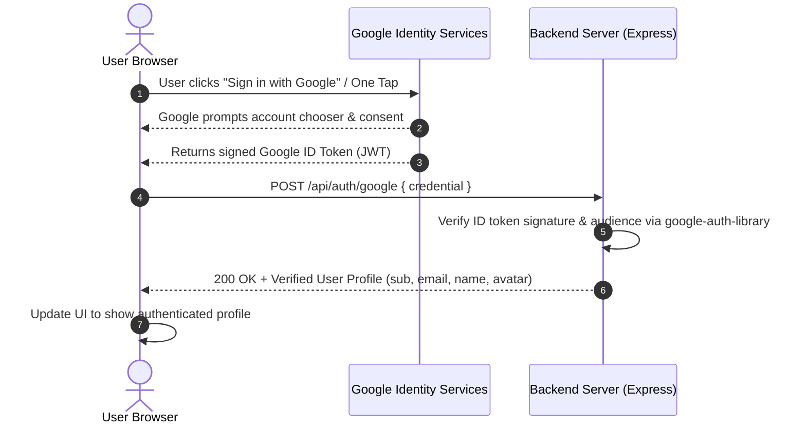

# Sign in with Google (Starter & Demo)

A modern, production-ready implementation of **Sign in with Google** using the official **Google Identity Services (GIS)** JavaScript SDK and a secure **Node.js / Express** backend for ID token cryptographic verification.

---

## 🚀 Features

- **Google Identity Services (GIS) SDK**: Uses Google's latest authentication client (`accounts.google.com/gsi/client`).
- **Official Google Button & One Tap**: Displays Google's branded sign-in button with support for One Tap prompts.
- **Secure Backend Verification**: Validates Google ID tokens (`JWT`) using Google's official `google-auth-library` to guarantee authenticity.
- **Zero Frontend Hardcoding**: Automatically fetches configuration from the server (`/api/config`) or allows dynamic testing in the UI.
- **User Profile Display**: Demonstrates extracting verified claims (Google User ID `sub`, name, email, avatar image, verified status).

---

## 🛠️ Project Structure

```
sign-in-google/
├── public/
│   ├── index.html       # Sign-in UI & User Profile layout
│   ├── style.css        # Responsive styling
│   └── app.js           # GIS initialization & auth handler
├── src/
│   └── server.js        # Express server verifying Google ID tokens
├── .env.example         # Environment variables template
├── package.json         # Scripts and dependencies
└── README.md            # Documentation
```

---

## 📋 Prerequisites

- **Node.js** v18+ (tested on Node.js 20 & 24)
- A **Google Cloud Platform (GCP)** account to obtain an OAuth 2.0 Client ID

---

## 🔑 Google Cloud Console Setup

1. Open the [Google Cloud Console](https://console.cloud.google.com/).
2. Select or create a new GCP project.
3. In the navigation menu, navigate to **APIs & Services** > **OAuth consent screen**:
   - Choose **External** (or **Internal** if using Google Workspace).
   - Enter your **App Name**, **User support email**, and **Developer contact information**.
   - Under **Scopes**, ensure `.../auth/userinfo.email` and `.../auth/userinfo.profile` are present.
   - Complete the remaining steps.
4. Navigate to **APIs & Services** > **Credentials**:
   - Click **+ CREATE CREDENTIALS** > **OAuth client ID**.
   - Select Application type: **Web application**.
   - Under **Authorized JavaScript origins**, add:
     - `http://localhost:3000`
     - `http://localhost`
   - Click **Create**.
5. Copy your **Client ID** (formatted like `xxxxxxxxxxxx-xxxxxxxxxxxxxxxx.apps.googleusercontent.com`).

---

## ⚡ Quick Start

### 1. Clone & Install Dependencies

```bash
git clone https://github.com/ShadowSnake447/sign-in-google.git
cd sign-in-google
npm install
```

### 2. Configure Environment

Copy `.env.example` to `.env`:

```bash
cp .env.example .env
```

Open `.env` and set your Client ID:

```env
PORT=3000
GOOGLE_CLIENT_ID=your-google-client-id.apps.googleusercontent.com
```

### 3. Start the Server

```bash
# Production mode
npm start

# Development mode (with auto-reload on changes)
npm run dev
```

Visit [http://localhost:3000](http://localhost:3000) in your browser.

---

## 🔄 How the Flow Works



---

## 📡 API Endpoints

### `GET /api/config`
Returns client configuration status to the frontend.
```json
{
  "clientId": "your-client-id.apps.googleusercontent.com",
  "isConfigured": true
}
```

### `POST /api/auth/google`
Accepts a Google ID token credential and cryptographically verifies it with Google's public keys.
- **Request Body:**
  ```json
  {
    "credential": "<Google_ID_Token_JWT>"
  }
  ```
- **Response (200 OK):**
  ```json
  {
    "success": true,
    "message": "Google authentication successful",
    "user": {
      "id": "108234857293847291032",
      "email": "user@gmail.com",
      "name": "Jane Doe",
      "givenName": "Jane",
      "familyName": "Doe",
      "picture": "https://lh3.googleusercontent.com/...",
      "emailVerified": true,
      "hostedDomain": null
    }
  }
  ```

### `GET /api/health`
Health check endpoint returning server status.
```json
{
  "status": "ok",
  "timestamp": "2026-11-19T02:44:43.314Z"
}
```

---

## 🔒 Production Checklist

- [ ] **HTTPS**: Google Identity Services requires HTTPS in production (HTTP is only permitted on `localhost`).
- [ ] **Session Management**: After verifying the ID token on `/api/auth/google`, establish an HTTP-only secure cookie or session JWT rather than passing credentials repeatedly.
- [ ] **Origin Verification**: Keep Authorized JavaScript origins in the Google Cloud Console updated with your production domains.
- [ ] **CSRF Protection**: Use a nonce or state parameter when rendering the button to prevent CSRF attacks.

---

## 📄 License

MIT
